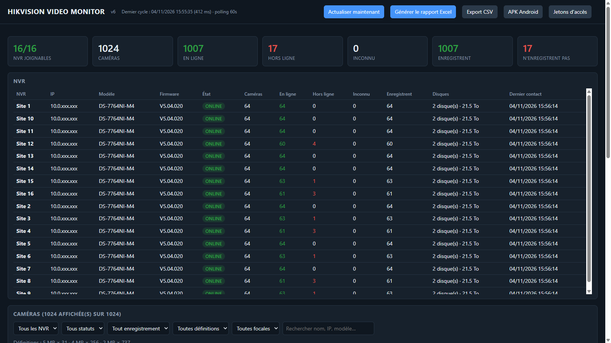

# Hikvision Video Monitor

**Supervision de parc vidéo Hikvision qui produit une preuve, pas seulement des images.**

Un agent autonome interroge vos enregistreurs existants (ISAPI, lecture seule), horodate chaque
changement d'état, et génère le rapport Excel attendu par le client — sans cloud, sans
abonnement par caméra, sans remplacer le matériel.



## Le problème

Sur un parc de quelques centaines de caméras, personne ne sait à un instant donné combien sont
hors ligne, lesquelles n'enregistrent plus, ni depuis quand. Le prestataire qui doit prouver son
travail recompte à la main ; le client découvre la panne des semaines plus tard.

## Ce que fait le produit

| Fonction | Détail |
|---|---|
| Collecte | ISAPI Hikvision (HTTP Digest), **lecture seule**, toutes les 60 s |
| Surveillance | transitions d'état : en ligne / hors ligne, enregistrement arrêté, disque en défaut |
| Historique | chaque changement horodaté en base SQLite, requêtable sur 30 j, 6 mois, 1 an |
| Rapport | Excel calqué sur le modèle du client (Summary, Camera Performance, Daily Log) |
| Captures | vignette 1920×1080 à la demande, prise **directement sur la caméra** |
| Inventaire | NVR, canal, nom, modèle, définition (MP), focale, statut, dernière vue |
| Accès | jetons par personne, révocables, rôle super administrateur |
| Interfaces | dashboard web installable (PWA) + application Android (APK) |

## Architecture

```
NVR Hikvision ──ISAPI──> Agent (Python) ──> SQLite ──> Dashboard / API / Excel
                              │
                              └── capture JPEG à la coupure
```

Aucun appel à un modèle de langage à l'exécution : les « agents » sont des modules déterministes
(collecteur, comparateur, rapporteur). Résultat reproductible, coût variable nul, données qui ne
sortent pas du réseau.

## Installation

Prérequis : un PC Windows (2 Go RAM, 20 Go disque), Python 3.11+ **ou** l'exécutable fourni.

```bash
pip install -r requirements.txt
cp config/.env.example config/.env      # renseigner NVR_USER / NVR_PASS / NVR1..
python src/main.py
```

Dashboard : <http://127.0.0.1:8765>

Exécutable autonome : `python -m PyInstaller --onefile --name HikvisionMonitor \
  --add-data "src/static;src/static" src/main.py`

## Configuration

`config/.env` — jamais versionné.

```ini
NVR_USER=utilisateur
NVR_PASS=A-REMPLIR
NVR1=SITE-A|192.168.1.10|80|Batiment A
POLL_INTERVAL=60
DASHBOARD_HOST=0.0.0.0
DASHBOARD_TOKEN=
ALLOW_NVR_WRITE=false
```

- `DASHBOARD_HOST=127.0.0.1` : poste local seulement. Toute autre valeur **exige** `DASHBOARD_TOKEN`.
- `ALLOW_NVR_WRITE=false` : lecture seule stricte (défaut). `true` autorise le renommage des
  caméras, qui écrit alors sur le NVR puis sur la caméra elle-même.

## Jetons d'accès

| Jeton | Où | Droits |
|---|---|---|
| maître | `DASHBOARD_TOKEN` | accès complet + création/révocation des jetons |
| individuel | table `tokens` | lecture du parc et des exports |

`generer-jeton-admin.bat` (Windows) génère le jeton maître et l'écrit dans `config/.env`.
Seul le SHA-256 des jetons individuels est stocké ; ils s'affichent une fois à la création.

## API

`GET /api/summary` · `GET /api/cameras` · `GET /api/events?days=30` · `GET /api/cameras.csv` ·
`GET /api/events.csv` · `POST /api/export` · `GET /api/snapshot?nvr_id=…&channel=…` ·
`POST /api/camera/rename` · `POST /api/camera/lens` · `GET|POST /api/tokens` · `GET /api/me`

Authentification : en-tête `X-Auth-Token` ou paramètre `?token=`.

## Tests

```bash
python tests/test_store.py     # 9 tests
python tests/test_export.py    # 7 tests
```

## Limites connues

- Le NVR ne renvoie qu'un JPEG du sous-flux (704×576) : les captures passent par la caméra.
- La focale n'est exposée ni par ISAPI ni par ONVIF : elle est saisie à la main.
- Le renommage de certaines caméras (firmware 5.8.10) exige deux écritures, caméra puis NVR.
- La reconnaissance faciale n'est pas supportée par le matériel de ce type de parc.
- Le rapport Excel suit le modèle fourni : 5 lignes de NVR dans la feuille Summary.

## Licence

Code publié à titre de démonstration technique. Tous droits réservés — contactez l'auteur avant
toute réutilisation.
